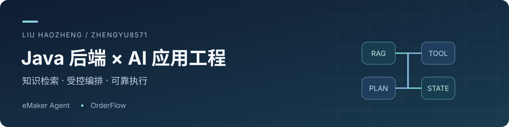

你好，我是 **刘浩铮**，关注 **Java 后端开发与 AI 应用工程**。

主要使用 Java / Spring AI 与 Python / LangGraph 构建 Agent 应用，围绕知识检索、工具调用、任务编排和可靠执行，完善从用户请求到结果核验的处理链路。

[GitHub](https://github.com/zhengyu8571) · [邮件联系](mailto:1308464015@qq.com)

## 代表项目

### [eMaker Agent](https://github.com/zhengyu8571/eMaker-agent)

**知识问答与受控任务编排 Agent**

`Java 17` · `Spring Boot` · `Spring AI` · `Redis` · `Elasticsearch` · `RabbitMQ`

面向课程咨询、知识问答和学习规划等场景，串联意图路由、混合检索、工具调用与多步任务执行。

- **混合 RAG**：文档异步入库，向量与 BM25 并行召回，经 RRF 融合、精排和上下文裁剪形成回答依据。
- **受控编排**：以 Skill / Capability 定义能力与权限，统一 Runtime 约束调用；多步计划经过依赖、参数绑定和预算校验后执行。
- **运行治理**：管理超时、取消和脱敏证据，校验终答引用，并区分正式会话历史与增强记忆。

[源码与功能](https://github.com/zhengyu8571/eMaker-agent) · [总体架构](https://github.com/zhengyu8571/eMaker-agent/blob/main/docs/架构设计.md) · [分模块架构](https://github.com/zhengyu8571/eMaker-agent#分模块架构与功能流程)

> 由于企业隐私与业务保密要求，展示版以天机学堂为框架，呈现 Agent 的设计与扩展能力。基础业务及 AI 代码来源、个人扩展与功能边界见项目说明。

### [OrderFlow](https://github.com/zhengyu8571/order-exception-agent-display)

**订单异常决策与可靠执行 Agent**

`Python` · `LangGraph` · `FastAPI` · `PostgreSQL` · `SSE`

围绕订单库存不足，完成事实调查、方案建议、人工审批、交付计划调整与结果核验。

- **受约束的决策**：并行调查与动态补查结合，模型在白名单内选择动作，由程序校验方案、资源条件和调用预算。
- **可恢复的审批**：通过持久状态与中断恢复等待人工决策，批准绑定方案、证据和资源摘要，执行前再次复核。
- **可靠执行与验证**：使用稳定操作 ID、事务账本和乐观锁处理结果未知与重复请求，通过进程退出、重启等故障场景检验恢复链路。

[源码与功能](https://github.com/zhengyu8571/order-exception-agent-display) · [架构与模块](https://github.com/zhengyu8571/order-exception-agent-display#系统架构) · [工作台界面](https://github.com/zhengyu8571/order-exception-agent-display#功能界面)

> 个人工程项目，使用模拟订单业务。LangGraph 提供图调度与 Checkpoint 等机制，项目侧实现业务规则、审批绑定、幂等操作、工作台与故障验证。

## 技术方向

| 方向 | 项目中的实践 |
| --- | --- |
| 后端开发 | Java / Spring Boot、Python / FastAPI、HTTP API、SSE |
| AI 应用 | Spring AI、LangGraph、Hybrid RAG、MCP、结构化决策与工具调用 |
| 数据与任务 | MySQL、PostgreSQL、Redis、Elasticsearch、RabbitMQ |
| 可靠性 | 权限与规则校验、执行预算、幂等账本、乐观锁、故障恢复与结果核验 |

## 我关注的工程问题

- 模型可以提出方案，执行权限和业务约束由程序落实。
- 回答需要可追溯的依据，业务操作需要可核查的结果。
- 为超时、取消、审批等待和进程退出设计明确的处理路径。

欢迎围绕 **Java 后端、RAG 与 Agent 工程实践** 交流。
